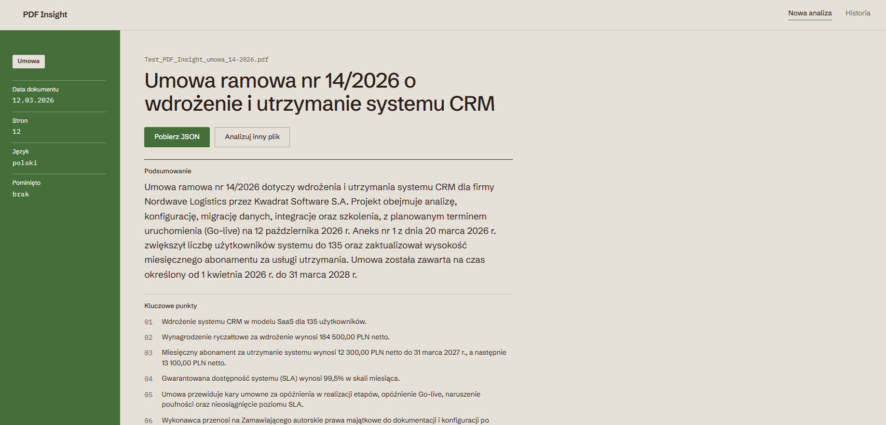
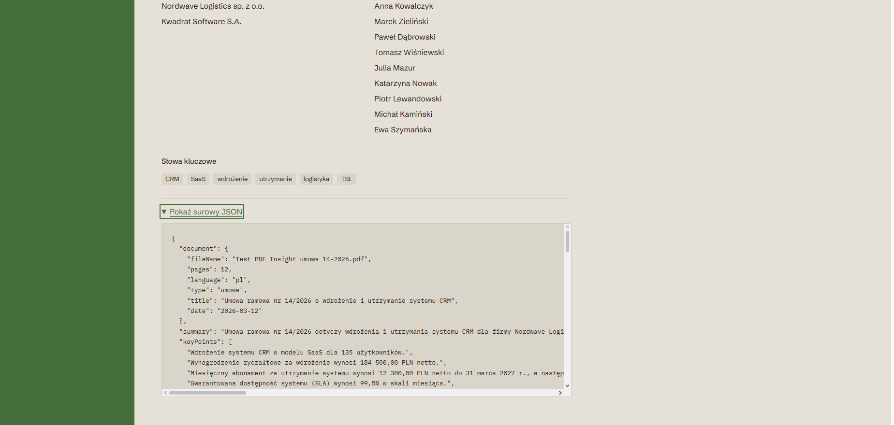
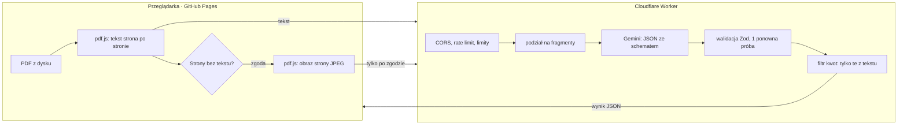

# PDF Insight

Aplikacja webowa, która wczytuje PDF, tworzy krótkie podsumowanie i zamienia treść dokumentu w uporządkowany JSON (strony umowy, kwoty, daty, kluczowe punkty, słowa kluczowe).

**Demo:** https://dyskna.github.io/pdf-reader/





## Jak to działa



1. **Przeglądarka** czyta PDF przez `pdfjs-dist` i składa tekst w linie z oznaczeniem `[Strona N]`. Plik PDF nigdy nie opuszcza przeglądarki.
2. Strony bez warstwy tekstowej (skany) są wykrywane. Użytkownik decyduje, czy wysłać ich obrazy do AI (OCR), czy je pominąć. Pominięte strony są widoczne w wyniku i w polu `skippedPages`.
3. **Worker** (Cloudflare) trzyma klucz Gemini, sprawdza origin, limity i rate limit, dzieli długie dokumenty na fragmenty po granicach stron i analizuje je równolegle.
4. **Gemini** zwraca JSON według schematu generowanego z tego samego schematu Zod, którym potem walidujemy odpowiedź.
5. Wynik trafia do widoku, do historii (ostatnie 10 analiz w `localStorage`) i można go pobrać jako plik JSON.

## Najważniejsze decyzje

- **Do AI trafia tekst, a nie cały PDF.** PDF zawiera więcej niż treść: obrazy (podpisy, pieczątki), metadane, komentarze, załączniki i wcześniejsze wersje z zapisów przyrostowych. Wysyłamy tylko to, co potrzebne do analizy. Tekst z pdf.js służy też do kontroli kwot zwróconych przez model.
- **OCR tylko za zgodą.** Skany bywają najbardziej wrażliwą częścią dokumentu (podpisy, dowody osobiste), dlatego obraz strony wysyłamy dopiero po świadomej decyzji użytkownika.
- **Prompt injection:** tekst dokumentu idzie w ogranicznikach z losowym znacznikiem, a instrukcja systemowa traktuje dokument i obrazy jako dane. W testach model ignorował jawne i ukryte (biały tekst) polecenia w treści PDF.
- **Filtr ugruntowania kwot:** kwota zostaje w wyniku tylko wtedy, gdy jej wartość jest w tekście z pdf.js (także w zapisie „212,4 mln zł”). Kwoty ze skanów są oznaczone `source: "ocr"`.
- **Długie dokumenty:** tekst powyżej 40 000 znaków dzielimy po granicach stron, fragmenty analizujemy równolegle, a jedno krótkie wywołanie robi końcowe podsumowanie. Wszystko mieści się we wspólnym limicie 28 s.
- **Jeden schemat:** `web/src/lib/schema.ts` (Zod) jest źródłem prawdy dla przeglądarki, Workera i schematu JSON wysyłanego do Gemini.
- **Bez zbędnych zależności:** Gemini przez zwykły `fetch`, pobieranie JSON przez `Blob`, formatowanie przez `Intl`, nawigacja bez routera. Czcionki hostowane z aplikacją (Fontsource), bez zapytań do Google Fonts.
- **Content-Security-Policy:** strona może łączyć się tylko z własną domeną i Workerem.

## Uruchomienie lokalne

Wymagania: Node.js 24, npm 11, konto Google AI Studio (klucz Gemini).

```bash
npm ci

# Worker: klucz i dozwolony origin w pliku .dev.vars (jest w .gitignore)
cp worker/.dev.vars.example worker/.dev.vars   # wpisz swój GEMINI_API_KEY
npm run dev -w worker                          # http://localhost:8787

# Aplikacja (w drugim terminalu)
cp web/.env.example web/.env.local             # VITE_API_URL=http://localhost:8787
npm run dev -w web                             # http://localhost:5173/pdf-reader/
```

Sprawdzenia (te same co w CI):

```bash
npm run lint && npm run format:check && npm run typecheck && npm test && npm run build
```

## Zmienne środowiskowe

| Nazwa                                           | Gdzie                                                                              | Opis                                                        |
| ----------------------------------------------- | ---------------------------------------------------------------------------------- | ----------------------------------------------------------- |
| `VITE_API_URL`                                  | zmienna repo GitHub (Actions → Variables), lokalnie `web/.env.local`               | adres Workera; trafia też do CSP                            |
| `GEMINI_API_KEY`                                | sekret Workera (`wrangler secret put GEMINI_API_KEY`), lokalnie `worker/.dev.vars` | klucz Gemini; **nigdy** nie trafia do frontendu ani do repo |
| `GEMINI_MODEL`                                  | `worker/wrangler.jsonc`                                                            | model Gemini, obecnie `gemini-3.1-flash-lite`               |
| `ALLOWED_ORIGIN`                                | `worker/wrangler.jsonc`, lokalnie `worker/.dev.vars`                               | jedyny origin, który może wołać Workera                     |
| `CLOUDFLARE_API_TOKEN`, `CLOUDFLARE_ACCOUNT_ID` | sekrety repo GitHub                                                                | deploy Workera z GitHub Actions                             |

## Testy

- **Jednostkowe (Vitest):** 63 testy w `web/` (odczyt i składanie linii, wykrywanie skanów, schemat, stany ekranu, historia, formatowanie, nazwa pliku JSON) i 60 w `worker/` (endpoint z zamockowanym Gemini, limity, prompt, dzielenie i scalanie fragmentów, filtr kwot, normalizacja walut).
- **CI:** każdy PR uruchamia lint, format, typecheck, testy i build (Worker: `wrangler deploy --dry-run`). Deploy tylko po merge'u do `main`.
- **Testy końcowe na produkcji** (prawdziwy Gemini, Edge przez Playwright):

| Dokument                                                                          | Czas      | Wynik                                                                                                                          |
| --------------------------------------------------------------------------------- | --------- | ------------------------------------------------------------------------------------------------------------------------------ |
| umowa 12 stron, dwie kolumny stron umowy, skan aneksu, próba sterowania modelem   | 6,5–7,5 s | obie strony umowy, aneks ze skanu w podsumowaniu, polecenie z dokumentu zignorowane; bez zgody na OCR ostrzeżenie o stronie 11 |
| umowa najmu 22 strony (3 fragmenty), ukryty biały tekst z poleceniem              | 9–14 s    | polecenia zignorowane; po poprawkach z etapu 7 bez błędów walidacji                                                            |
| raport roczny 38 stron (4 fragmenty), rozdział po angielsku, przypis z poleceniem | 7–20 s    | `language: pl`, wyniki z całego dokumentu, opinia biegłego ze skanu                                                            |
| zestawienie 12 faktur, VAT 23/8/0%, faktura korygująca, EUR                       | 4,9 s     | kwoty i kontrahenci; typ „raport” (zestawienie), także bez polecenia w treści                                                  |

## Bezpieczeństwo

- Klucz Gemini istnieje tylko jako sekret Workera. Sprawdzone w całej historii git, w zbudowanych paczkach i w plikach repo: brak.
- Worker przyjmuje tylko żądania z `ALLOWED_ORIGIN` (inne dostają 403), ma rate limit 10 żądań na minutę per IP oraz limity: 300 000 znaków tekstu, 10 skanów po 1,5 MB, 10 MB na żądanie.
- Każda odpowiedź modelu przechodzi walidację Zod (1 ponowna próba), a błędy wracają do użytkownika jako czytelne komunikaty po polsku.
- W kodzie nie ma `any`, `console.log` ani `dangerouslySetInnerHTML` (pilnuje ESLint).

## Znane ograniczenia

- **Darmowy tier Gemini.** Demo działa na darmowym limicie. Warunki Gemini API mówią, że dla użytkowników z EOG powinno się używać płatnego tieru, a dane z darmowego tieru mogą być wykorzystywane do ulepszania usług Google. Wersja produkcyjna wymaga płatnego tieru (billing w Google Cloud z alertem budżetu). Do tego czasu: nie wgrywaj dokumentów z danymi wrażliwymi.
- **Zmienna dostępność modeli na darmowym tierze.** Szybkość modeli zmienia się z dnia na dzień (w trakcie prac zmienialiśmy model z `gemini-3.8-flash` przez `gemini-3.5-flash-lite` na `gemini-3.1-flash-lite`). Przy przeciążeniu użytkownik dostaje „Usługa AI jest chwilowo przeciążona” albo „Analiza trwała zbyt długo” z przyciskiem „Spróbuj ponownie”.
- **Kolejność tekstu w złożonych układach.** Używamy kolejności z pdf.js i składamy elementy w linie; bloki obok siebie oddziela `|`. Przy nietypowych układach (np. kolumny drukowane wierszami naprzemiennie) tekst bywa przemieszany. Model zwykle sobie z tym radzi, ale nie zawsze.
- **OCR zależy od modelu.** Jakość odczytu skanów zależy od Gemini i rozdzielczości obrazu (ok. 150 DPI). Kwot ze skanów nie da się sprawdzić z tekstem, więc są oznaczone `source: "ocr"`.
- **Kwoty.** Filtr usuwa kwoty, których nie ma w tekście; kwoty zapisane słownie albo wyliczone przez model mogą zostać usunięte.
- **Wykrywanie skanów** opiera się na progu 30 znaków na stronie; prawie pusta strona z tekstem też zostanie potraktowana jak skan.
- **Nowe przeglądarki.** pdf.js 6 wymaga Chrome 140+, Firefox 133+ albo Safari 18.2+.
- **Ochrona Workera.** Sprawdzanie originu blokuje obce strony w przeglądarce, ale nie jest uwierzytelnieniem (np. `curl` może podać dowolny origin). Rate limit działa w przybliżeniu i osobno w każdej lokalizacji Cloudflare.
- **Historia** zapisuje wyniki (bez treści PDF) w `localStorage` tego urządzenia; można ją wyczyścić przyciskiem.

## Struktura repo

```
web/      React + Vite + TypeScript (GitHub Pages)
  src/components/   widoki: start, postęp, zgoda na skany, błędy, wynik, historia
  src/lib/          schemat Zod, odczyt PDF, historia, formatowanie
  src/hooks/        logika ekranu (stany analizy, historia)
  src/api/          klient Workera
worker/   Cloudflare Worker (proxy do Gemini z kluczem)
design/   eksport z Claude Design (wzorzec wyglądu)
.github/  CI: web.yml (Pages), worker.yml (Cloudflare)
```

## Jak powstał projekt

Projekt powstał z Claude Code etapami opisanymi w [`CLAUDE.md`](CLAUDE.md), każdy etap jako osobny PR. Przebieg pracy, decyzje i pomyłki AI są w [`AI_LOG.md`](AI_LOG.md).
